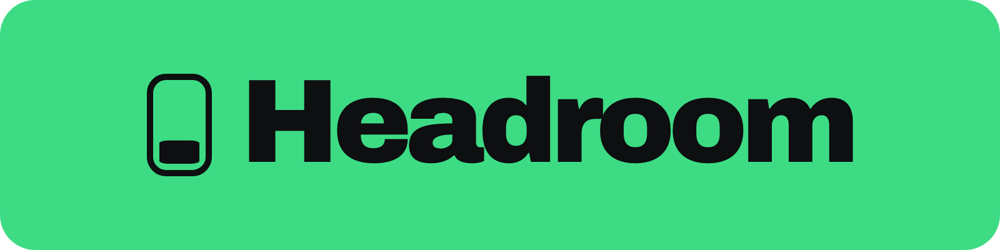
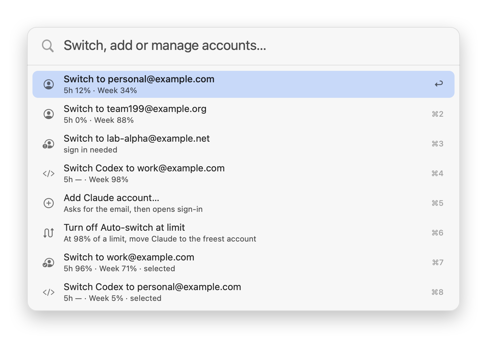
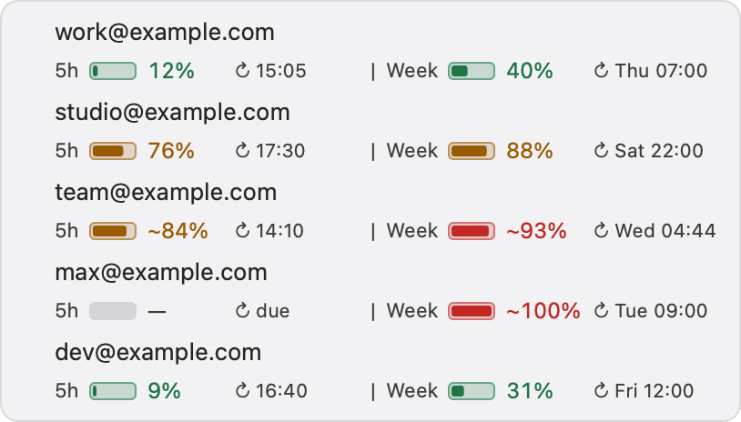
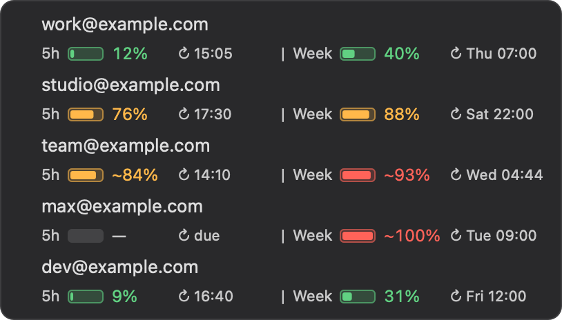
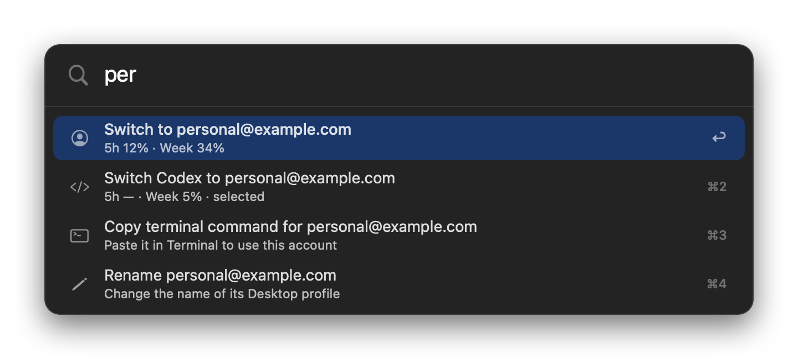

<div align="center">



### One palette for every Claude and Codex account

Switch Claude.ai in Chrome, Claude Code, Claude in Chrome and the Codex app together, and see five-hour and weekly usage at a glance.

<br />

[](https://github.com/paperfoot/claude-switcher/stargazers)
&nbsp;&nbsp;
[](https://x.com/longevityboris)

<br />

[](#install)
[](https://www.swift.org)
[](https://code.claude.com/docs/en/overview)
[](LICENSE)

[Quick start](#quick-start) · [Use it](#use-it) · [Auto-switch](#switch-automatically-near-a-limit) · [Install](#install) · [Troubleshooting](#troubleshooting)

</div>

---

A small native menu bar app for Macs with more than one Claude or Codex subscription. Pick a Claude account and Claude.ai in Chrome, Claude Code and the Claude in Chrome extension your agents use all move to it. Pick a Codex account and the Codex app reopens with it.

<p align="center">
  
</p>

<p align="center">
  
  
</p>

<sub>Example accounts. Which usage windows appear depends on the provider.</sub>

## Use it

Press **⌥Space** anywhere, or choose **Command…** in the menu bar. Type a few letters of an account, then press **↩**.

| Type | What happens |
| --- | --- |
| `work` | Switch Claude to work@example.com |
| `best` | Switch to the account with the most headroom |
| `codex personal` | Switch Codex to personal@example.com |
| `add new@example.com` | Add an account |
| `reconnect codex work` | Sign in to a saved Codex account again |
| `auto` | Turn automatic switching near a limit on or off |
| `diagnostics` | Open diagnostics |
| `quit` | Quit the switcher |

**↑** and **↓** move through the suggestions, **⌘1**–**⌘9** pick one directly, and **⎋** closes the palette. Before you type, the palette lists the accounts with the most headroom first.

The menu bar menu shows every account with its usage. Click an email to switch. To use a different shortcut, set `"paletteShortcut": "ctrl+option+cmd+space"` (or any modifier chord) in `~/.config/claude-switcher/config.json` and restart the app; the menu shows the shortcut that registered.

<p align="center">
  
</p>

## Switch automatically near a limit

Type `auto` in the palette and turn on **Auto-switch at limit**. When the selected Claude account reaches 95% of its five-hour or weekly limit, the switcher moves Claude Code and every connected Chrome profile to the account with the most headroom, so long sessions keep going.

- The decision comes from [claude-swap's auto-switch engine](https://github.com/realiti4/claude-swap): it refreshes the target's login first, never lands on an account that is near its own limit, and avoids switching back and forth.
- Usage is polled at a pace Anthropic's usage endpoint accepts (roughly one request per account every few minutes, faster near the limit), so turning this on does not get accounts rate-limited.
- It never overrides a choice you just made: there is no automatic switch in the ten minutes after you pick an account yourself.
- Every automatic switch shows in the menu bar and in the menu, with the time.
- Codex is never switched automatically, because a Codex switch restarts the app.

Change the trigger with `"autoSwitchThreshold": 90` (50–99.9) in `~/.config/claude-switcher/config.json`. Running Claude Code sessions pick up the new login on their next request.

A Claude switch changes Claude.ai in each connected Chrome profile and the login that Claude Code uses. Your terminals, working directories and `~/.claude` history stay as they are. Claude Code normally picks up the new login on its next request; its Keychain cache can delay this by about 30 seconds. If a running process keeps its old login, stop it when you are ready and run `claude --resume` or `claude --continue`.

The menu bar icon spins during a switch and shows a green check when it is done. Amber means Code switched but Chrome needs attention. Red means the switch failed.

## Ask in plain words (optional)

Free-form requests such as “use the account with the most weekly quota for Claude” can be interpreted by [TypeSafe](https://typesafe.ai)'s Jev model if you store a TypeSafe API key. Jev is off by default. Local matching handles normal input offline.

```sh
printf %s "$TYPESAFE_API_KEY" | "/Applications/Claude Switcher.app/Contents/MacOS/claude-switcher" --set-typesafe-key
```

Remove the key with `--remove-typesafe-key`. The key lives in your login Keychain as **Claude Switcher TypeSafe**. When the palette cannot place what you typed, it offers **Ask Jev**; a confident, harmless answer runs straight away, and anything else waits for **↩**.

**Privacy:** a request goes to Jev only when you choose **Ask Jev**. The app then sends the typed request and the account emails and usage needed to choose an action. Nothing is sent to TypeSafe otherwise.

## Reading the gauges

Each account shows how much of its five-hour and weekly limits it has used.

| You see | Meaning |
| --- | --- |
| Green, amber, red | Below 70%, 70–89%, 90% or more |
| `~84%` | The reading is more than 20 minutes old |
| `—` | Unknown. An unknown value is never shown as zero |
| `↻ 19:10` | The next reset, in your time zone |
| `↻ due` | The reset has passed; waiting for a fresh reading |

Readings refresh about every five minutes and after your Mac wakes. They survive restarts. Cached readings expire after seven days.

Saved logins stay usable without you doing anything: the background usage checks keep the Claude Code and Codex logins of inactive accounts refreshed, and the Chrome companion saves renewed Claude.ai cookies for the account each profile is using.

## Install

You need:

- macOS 14 or later, with a Swift 6 toolchain
- [Claude Code](https://code.claude.com/docs/en/setup)
- [uv](https://docs.astral.sh/uv/getting-started/installation/) and `claude-swap==0.26.0`, for coordinated Claude switching
- Google Chrome, for the companion extension
- The official Codex desktop app, for Codex switching
- Node.js 22 or newer, only for Desktop history sharing

```sh
git clone https://github.com/paperfoot/claude-switcher.git
cd claude-switcher
uv tool install 'claude-swap==0.26.0'
CODESIGN_IDENTITY=- make install
python3 scripts/setup-coordinated.py
open -a "Claude Switcher"
```

This builds **Claude Switcher.app** on your Mac, signs it ad hoc and copies it to `/Applications`. There is no notarized download yet. Quit an older copy before you replace it.

The setup script imports the Claude Code accounts already listed in `~/.config/claude-switcher/config.json` and registers the Chrome companion's native host. It leaves the active Code account unchanged and never overwrites an account already saved in claude-swap.

To start the switcher at login, use the launch-at-login toggle in the palette, or run the app's executable with `--login-item on`.

## Connect Chrome once per profile

Chrome only runs an unpacked extension that you load yourself. The installer changes no browser policy.

1. In each Chrome profile you want to switch, open `chrome://extensions`, turn on **Developer mode** and choose **Load unpacked**.
2. Select `~/Library/Application Support/Claude Switcher/BrowserExtension`. In the file dialog, press ⇧⌘G and paste the path.
3. At [claude.ai](https://claude.ai), sign in to an account you added to the switcher. The companion saves it automatically; its popup also offers **Save this Claude login**.
4. Choose **Add another account** in the companion and sign in to the next account. Repeat for each account. Use this button instead of Claude's own sign-out, so the saved session is not revoked.

The palette's **Connect Chrome…** command shows the same steps. Each Chrome profile follows the selected account when it next connects, so a profile that was closed during a switch catches up later.

Updates need nothing from you: from companion 0.9.1 on, the companion notices within a minute that the app installed newer files and reloads itself. Your saved accounts stay in the Keychain.

## Codex accounts

The Codex section lists the same emails as your Claude accounts, unless `~/.config/claude-switcher/codex-settings.json` lists others. Connect each account once through the official Codex browser login. The switcher verifies the login and saves it in the Keychain. If a saved login expires, type `reconnect codex` and the account in the palette.

A switch checks the target account first, asks Codex to quit normally, swaps the login in `~/.codex/auth.json`, verifies it and reopens Codex. It never force-quits Codex. If active work blocks a normal quit, finish that work and try again.

- Codex CLI processes that are already running keep their old login until you restart or resume them.
- The ChatGPT website account is not switched.
- If `cli_auth_credentials_store` is set to `keyring`, `auto` or `ephemeral`, switching stops without changing that setting.

Codex has to reopen because it offers no supported way for another app to reload a running app's login, and replacing `auth.json` alone does not change its cached login. See [Codex account switching](docs/codex-account-switching.md).

Aliases are optional. They map a displayed email to the account's actual provider email:

```json
{
  "emails": ["work@example.com", "personal@example.com", "lab@example.org"],
  "aliases": {
    "lab@example.org": "provider@example.org"
  }
}
```

## Agent commands

Install the helper, then link the [Claude accounts skill](skills/claude-accounts/SKILL.md) folder into your agent's skills directory. The skill lists the commands and how to verify a switch.

```sh
install -m 755 scripts/claude-accounts ~/.local/bin/claude-accounts
```

```sh
claude-accounts accounts                  # saved Claude accounts and usage status
claude-accounts chrome-status             # verified account in each connected Chrome profile
claude-accounts chrome work@example.com --expect-profiles 2
claude-accounts claude work@example.com   # Chrome and Claude Code together
claude-accounts extension work@example.com  # re-sign Chrome's official Claude extension only
claude-accounts refresh-code              # sync a stale Code credential file after `cswap add`
claude-accounts logs                      # the latest 50 switch events
```

`chrome` switches Claude.ai in the connected Chrome profiles and leaves Claude Code alone. `--expect-profiles 2` refuses to start unless two profiles are connected. Neither command changes Codex. Output is JSON.

The app's executable offers the same operations to scripts:

```sh
APP="/Applications/Claude Switcher.app/Contents/MacOS/claude-switcher"
"$APP" --accounts                          # Claude accounts as JSON
"$APP" --switch work@example.com           # switch Chrome and Claude Code
"$APP" --switch-status                     # current coordinated state as JSON
"$APP" --codex-accounts                    # Codex accounts and usage
"$APP" --codex-connect lab@example.org     # save a Codex login through the browser
"$APP" --codex-switch personal@example.com # switch Codex and reopen it
"$APP" --help                              # every option
```

## How it works and what stays private

- **Claude Code:** [claude-swap 0.26.0](https://github.com/realiti4/claude-swap/releases/tag/v0.26.0) saves and restores the default Claude Code login and works with Claude's credential locks. Code keeps its usual history directory.
- **Chrome:** a Manifest V3 companion saves Claude.ai sessions in the macOS Keychain through a local native-messaging host. It checks the email before saving and after switching, and restores the previous cookies if a switch fails. It touches Claude.ai cookies only, never Google accounts, Gmail or other sites. All Claude.ai tabs in one Chrome profile share one login.
- **Codex:** the official Codex runtime handles sign-in, identity checks and usage. Saved logins live in the Keychain.
- **Connection:** the app reaches Chrome's native host over a private local Unix socket. It opens no listening network port and uses no remote debugging.
- **Files:** settings and the usage cache live in `~/.config/claude-switcher/` with private permissions. claude-swap keeps its own account store in `~/.claude-swap-backup/`.
- **Logs:** the switch log stores results, timings, the failing step and HTTP status. It never stores tokens, cookies, account emails or URLs. Command output such as `--accounts` includes account emails and usage, but no tokens or cookies.

- **Claude in Chrome (the official extension agents use for browser control):** after Chrome switches, the companion turns the official extension off and on again. That clears only its session; its shortcuts and scheduled tasks stay. If it already belongs to the selected account it reconnects by itself. Otherwise the switcher presses its **Log in** button and approves Anthropic's own consent page, but only for the official extension and only when the page shows the selected email. Claude Code's browser tools then reach Chrome on the new account. Pressing **Log in** needs macOS Accessibility for Claude Switcher; macOS asks once.

Claude Desktop keeps its own sign-in and is not switched. See [how the official extension follows a switch](docs/chrome-extension-switching.md). Claude's cookie, credential and extension formats are not public interfaces, so a Claude update can require maintenance here.

## Claude Desktop extras

The palette also manages Claude Desktop:

- **Profiles** (type `desktop`): open separate Claude Desktop profiles, each with its own sign-in.
- **Code history sharing** (type `history`): carry local Code conversations across your Desktop accounts after a verified sign-in, with undo. See [Desktop Code history](docs/desktop-history.md).
- **Update helpers** (type `updates`): reopen profiles after Claude updates itself, pause Claude's automatic updates, or install a downloaded update once its profiles have quit.

Desktop sign-ins are separate from Chrome and Claude Code. Switching a Claude account does not sign Desktop in.

## Troubleshooting

- **Chrome does not respond, or a Chrome switch fails.** Open `chrome://extensions` in that profile, click **Reload** on Claude Switcher Companion and try once more. A failed restore does not by itself mean the login expired.
- **“Claude extension needs attention”, or agents report no connected browser.** Allow Claude Switcher in System Settings → Privacy & Security → Accessibility, then run `claude-accounts claude <email>` again or select the account in the palette. To repair only the extension, run `claude-accounts extension <email>`.
- **Code switched but Chrome did not.** The verified Code selection stays. Fix Chrome, then select the account again. In JSON output, `ok: true` with `browserReady: false` means the same thing.
- **“Sign in needed”.** The saved login expired or was revoked. For Chrome, sign in again through the companion's **Add another account**. For Codex, type `reconnect codex` and the account in the palette.
- **Claude Code still uses the old account.** Wait about 30 seconds for its Keychain cache. After a manual `cswap add`, run `claude-accounts refresh-code`.
- **macOS asks whether Claude Switcher may use a Keychain item.** Since 1.0.1 the switcher keeps its saved logins through Apple's `security` tool, which never asks. Updating from 1.0.0 can ask once per saved Codex login while it moves them over; after that, rebuilds and updates do not ask again.
- **“Chrome login … expires”.** Saved Claude.ai logins last a few weeks. The menu warns three days ahead; sign in to that account in Chrome once and the companion saves the fresh login.
- **Find out what happened.** Type `switch log` in the palette, or run `claude-accounts logs`. Redact emails and paths before you post anything in an issue.

## Development

```sh
swift test
scripts/check-menu-refresh.sh
node --test history/*.test.mjs
node --test browser-extension/*.test.js
python3 -m unittest discover -s bridge -p 'test_*.py'
swift build -c release
CODESIGN_IDENTITY=- scripts/bundle.sh
```

See [CONTRIBUTING.md](CONTRIBUTING.md) and the [changelog](CHANGELOG.md).

## Credits

Maintained by [Paperfoot](https://github.com/paperfoot). Forked from [Kevin Chau's Claude Switcher](https://github.com/kevinchau/claude-switcher), with original history and MIT attribution preserved. Coordinated Code switching uses [Onur Cetinkol's claude-swap](https://github.com/realiti4/claude-swap), also MIT licensed. The Codex app-server RPC transport adapts code from [liuzhao1225/codex-account-switcher](https://github.com/liuzhao1225/codex-account-switcher) under the MIT license, for the RPC transport only; see [ThirdParty/CodexAccountSwitcher-LICENSE](ThirdParty/CodexAccountSwitcher-LICENSE). Desktop history sharing adapts atomic writes, process checks, locking and legacy recovery from [claude-transplant 4.1.0](https://github.com/vitaliyhayda/claude-transplant), MIT licensed; see the [pinned source and local changes](ThirdParty/ClaudeTransplant-NOTICE.md).

## License

[MIT](LICENSE). Not affiliated with Anthropic or OpenAI.
